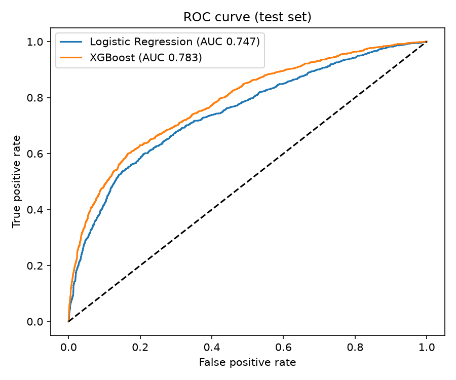
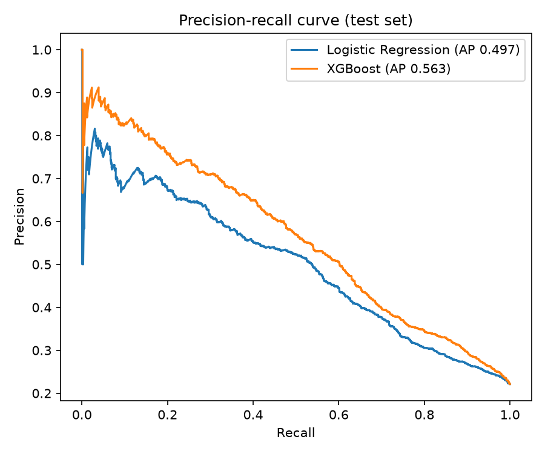
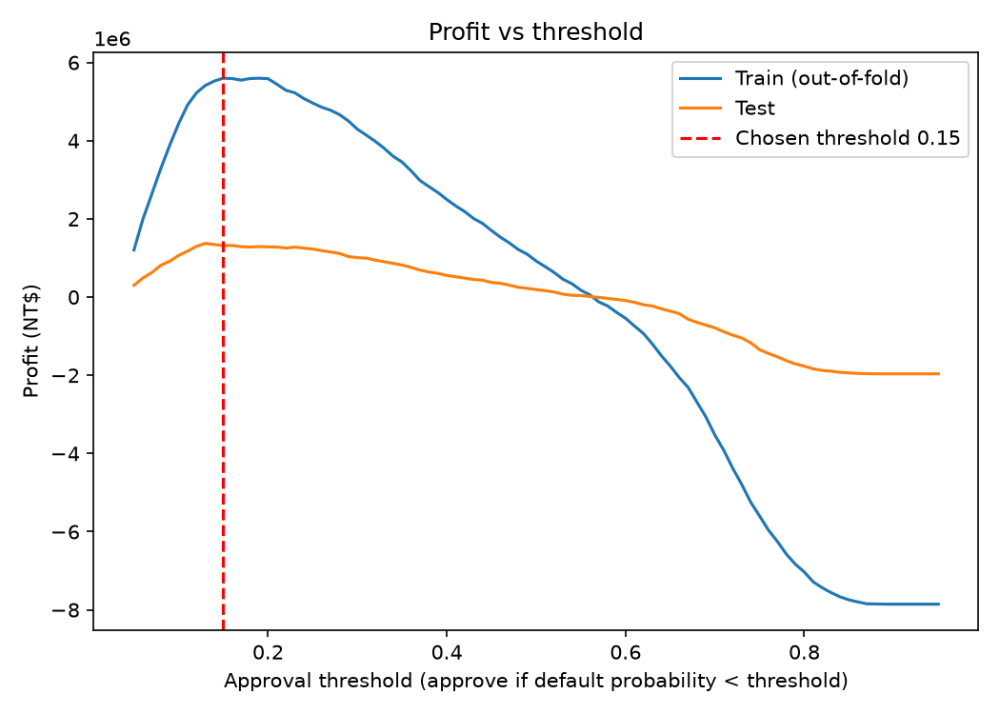
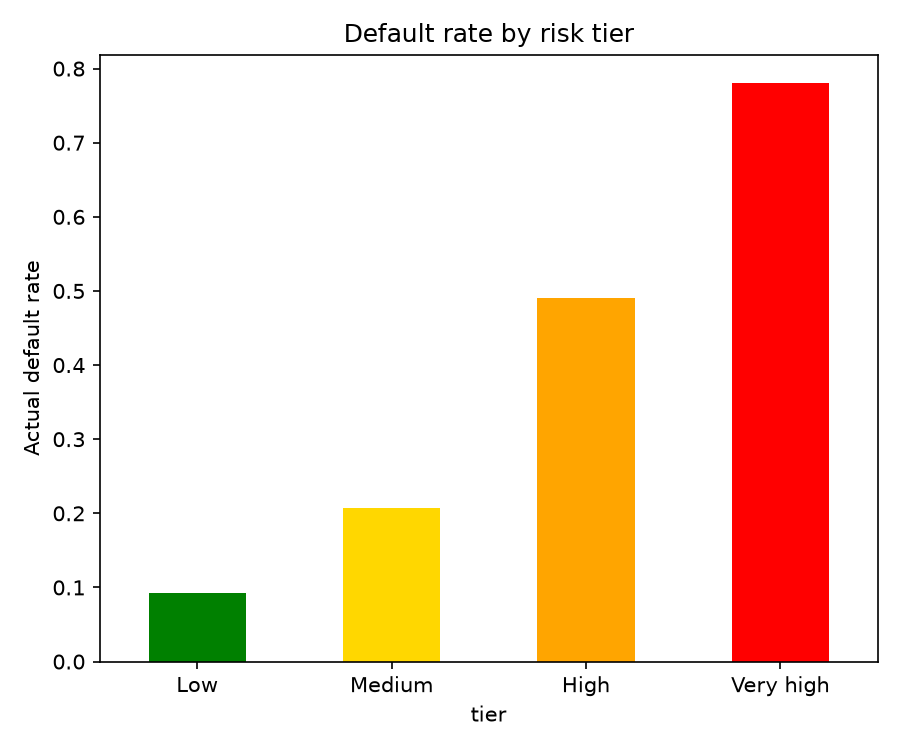
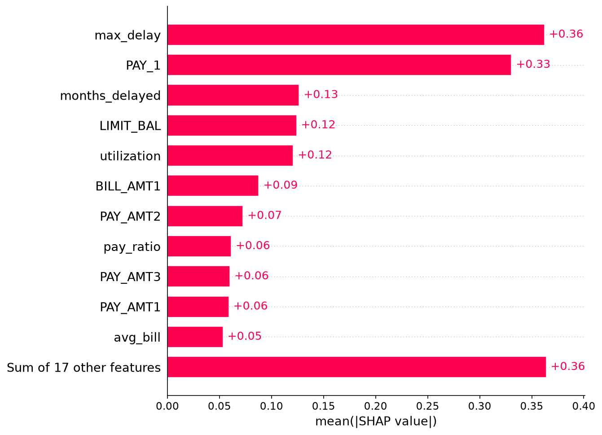
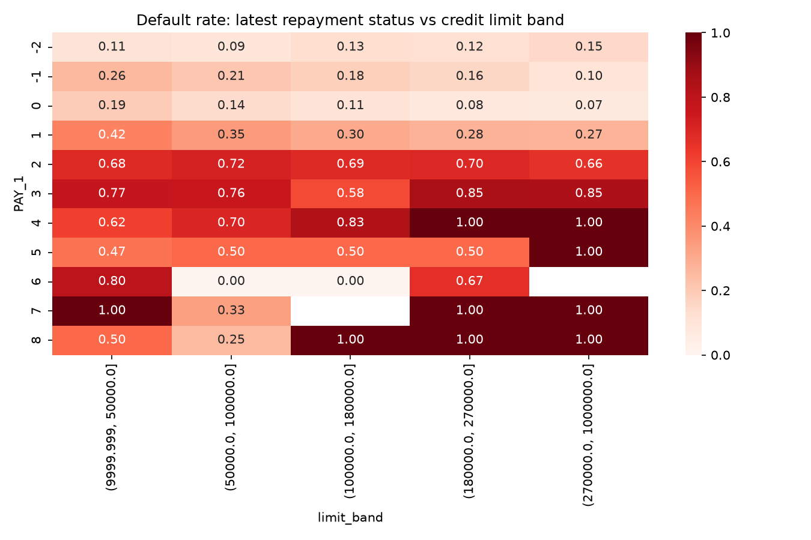
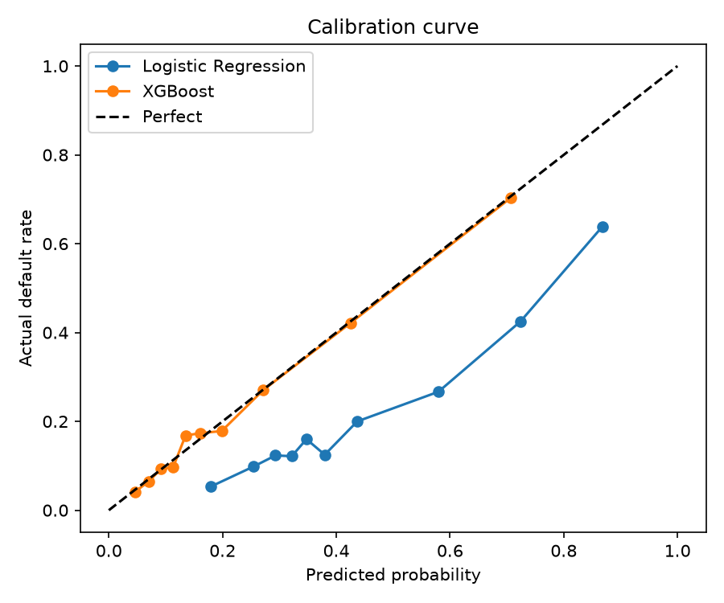

# Loan Default Risk Prediction & Profit-Optimised Approval Policy

End-to-end credit risk project: exploratory analysis, default prediction (Logistic Regression vs XGBoost),
SHAP explainability, a **profit-maximising approval threshold**, risk tiers, and a Streamlit scoring app.

**Dataset:** UCI *Default of Credit Card Clients* (30,000 accounts, ~22% default rate), downloaded automatically.

## Key results

| Metric (test set) | Logistic Regression | XGBoost |
|---|---:|---:|
| ROC-AUC | 0.7470 | **0.7825** |
| PR-AUC | 0.4973 | **0.5625** |
| KS Statistic | 0.3896 | **0.4345** |

### Business impact

Using assumed costs of NT$1,000 profit per good loan
and NT$5,000 loss per default:

- Profit approving everyone: -NT$1,962,000
- Profit at default threshold (0.50): NT$192,000
- Profit at optimised threshold (0.15): NT$1,317,000
- Credit loss reduction: 78.2%
- Approval rate: 50.8%

## Figures

### Model Performance

**ROC Curve**



**Precision-Recall Curve**



### Business Analytics

**Profit Optimisation**



**Customer Risk Segmentation**



### Explainable AI (SHAP)

**Global Feature Importance**



### Exploratory Data Analysis

**Feature Correlation Heatmap**



### Probability Calibration



## Method
1. **Cleaning:** merged undocumented category codes (EDUCATION 0/5/6, MARRIAGE 0); no missing values.
2. **Features:** credit utilisation, repayment-to-bill ratio, max delay, number of delayed months.
3. **Models:** class-weighted Logistic Regression baseline vs XGBoost tuned with `RandomizedSearchCV` (3-fold CV).
4. **Evaluation:** ROC-AUC, PR-AUC, KS, recall at 50% precision, confusion matrix, calibration curve.
5. **Threshold:** profit curve computed on *out-of-fold training predictions*, so the test set stays untouched.
6. **Explainability:** SHAP beeswarm and bar plots; per-applicant waterfall in the app.
7. **Risk tiers:** test accounts banded by predicted probability (Low / Medium / High / Very high).

## Run it
```bash
python -m venv .venv
source .venv/bin/activate        # Windows: .venv\Scripts\activate
pip install -r requirements.txt
python src/get_data.py           # downloads data
python src/eda.py                # EDA figures
python src/train.py              # models, metrics, plots, saves models/model.joblib
streamlit run app.py             # scoring app
```

## Structure
```
src/get_data.py   download data       src/features.py  cleaning + features
src/eda.py        EDA figures         src/train.py     modelling + business layer
app.py            Streamlit app       reports/         metrics, tiers, figures
```

## Limitations
- Costs per good/bad loan are assumptions; real values depend on interest rates and recovery rates.
- Data is Taiwanese credit-card clients from 2005, so treat results as a demonstration, not a production scorecard.
- The app collapses 6 months of bills/payments into averages to keep the form short.
